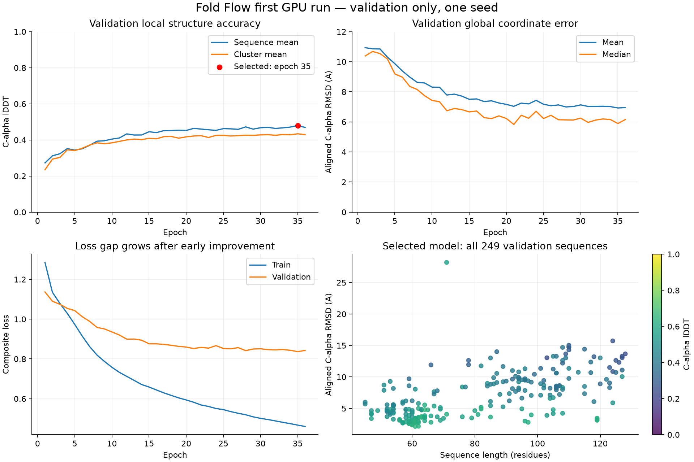

# 첫 GPU 학습 결과 분석

분석일: 2026-10-24. GPU 서버에 다시 접속하지 않고, 검증된 백업과 로컬 캐시만 사용했다.
최고 checkpoint는 validation lDDT로 선택된 35 epoch / 8,715 step이다.
마지막 checkpoint는 36 epoch 완료 후 37 epoch의 8번째 배치, 총 8,972 step에서 정상 중단됐다.
학습 완료나 조기 종료 판정이 아니라 사용자의 예산 결정에 따른 중단이다. Test는 읽지 않았다.

## 핵심 결론

학습은 정상적으로 진행됐고 validation 249개 모두 첫 epoch보다 lDDT가 개선됐다.
그러나 전체 train 평가에서 뚜렷한 일반화 격차가 확인됐고, 예측 backbone의 결합 기하도 불충분하다.
지금은 더 오래 학습하거나 모델을 크게 만드는 것보다, 구조 기하와 클러스터 단위 일반화의 개선을 우선한다.
이번 결과는 작동하는 첫 기준 모델이며, 고정밀 구조 예측 성공 기준에는 미달한다.

## 같은 최고 모델의 전체 train / validation 평가

| 지표 | Train 1,989개 | Validation 249개 |
|---|---:|---:|
| 평균 Cα lDDT | 0.727 | 0.480 |
| 중앙값 Cα lDDT | 0.762 | 0.465 |
| 평균 정렬 Cα RMSD | 2.76Å | 6.92Å |
| 중앙값 정렬 Cα RMSD | 1.75Å | 5.89Å |
| RMSD < 2Å | 1,165개 (58.6%) | 0개 |
| RMSD < 4Å | 1,633개 (82.1%) | 70개 (28.1%) |
| lDDT ≥ 0.60 | 1,610개 (80.9%) | 47개 (18.9%) |
| RMSD > 10Å | 68개 (3.4%) | 48개 (19.3%) |

Train/validation 전체를 MPS에서 평가했다. Validation lDDT는 CUDA 저장값과 동일했고,
평균 RMSD 차이는 약 1e-7Å였다. 디바이스 변경으로 인한 결과 차이로 보이지 않는다.
양 분할의 길이/클러스터 구성은 다르므로 평균 차이만으로 과적합의 모든 원인을 특정할 수는 없다.

## 학습 추세

첫 epoch → 최고 epoch에서 validation lDDT는 0.273 → 0.480,
평균 RMSD는 10.93 → 6.92Å로 개선됐다.
약 15–20 epoch 이후 validation 개선 폭은 작아지고 train loss는 계속 감소했다.
21 → 35 epoch 동안 train mean loss는 0.582 → 0.467,
validation lDDT는 0.464 → 0.480이었다. 정체가 완전한 무개선은 아니었지만,
더 긴 실행으로 목표 0.60에 도달할 근거는 부족하다.

Validation 78개 클러스터를 동일 가중치로 평균하면 lDDT 0.434다.
서열별 평균 0.480보다 낮아, 큰 클러스터가 서열별 평균을 높이는 영향이 있다.
클러스터 평균의 단순 bootstrap 95% 구간은 0.413–0.455다.
이는 선택된 validation checkpoint의 기술 통계이며 모델 선택 편향을 보정한 test 신뢰구간이 아니다.

## 길이별 성능

| 길이 | Train 개수 / lDDT | Validation 개수 / lDDT | Validation 중앙값 RMSD |
|---|---:|---:|---:|
| 40–64 | 145 / 0.774 | 105 / 0.547 | 3.72Å |
| 65–96 | 497 / 0.728 | 66 / 0.469 | 8.20Å |
| 97–128 | 1,347 / 0.721 | 78 / 0.398 | 9.28Å |

긴 단백질은 train에도 충분히 포함되지만 validation에서 크게 실패한다.
따라서 단순한 긴 서열 샘플 수 부족만으로 설명하기는 어렵다.
길이와 구조 유형/클러스터 구성은 함께 변하므로 길이 자체의 인과 효과로 해석하지 않는다.

리간드 접촉 없음 83개는 lDDT 0.501, 접촉 있음 166개는 0.469다.
이 차이만으로 리간드가 주된 원인이라고 결론 내릴 수 없다.
접촉 정의에는 이온/첨가제도 포함되며 길이와 구조 유형을 통제하지 않았다.

## 전역 접힘과 물리적 기하

| 진단 | Validation 예측 |
|---|---:|
| 서열 간격 <12인 쌍의 lDDT 평균 | 0.621 |
| 서열 간격 ≥12인 쌍의 lDDT 평균 | 0.386 |
| 장거리 contact precision / recall (전체 pair 합산) | 29.2% / 39.5% |
| 인접하지 않은 Cα 거리 <2Å인 단백질 | 196 / 249 (78.7%) |
| 예측 C–N 연결이 1.1–1.8Å를 벗어난 비율 | 53.1% |
| 단백질별 평균 C–N 절대 오차의 평균 | 0.461Å |
| 예측/정답 radius of gyration 비율 중앙값 | 0.963 |

장거리 contact는 서열 간격 ≥12, Cα 거리 <8Å로 정의했다.
lDDT 분해는 정답 거리가 15Å 미만인 pair에 대해 기존과 같은 0.5/1/2/4Å 허용오차를 사용했다.
일부 contact precision/recall macro 평균은 분모가 0인 단백질을 제외하므로 표에는 micro 값을 썼다.

정답의 Cα에는 같은 기준의 충돌이 0개였고, 정답 프레임을 같은 ideal backbone으로
복원한 대조군의 C–N 범위 이탈은 19,738개 연결 중 약 0.01%였다.
따라서 예측의 큰 위반을 ideal atom reconstruction 오차만으로 설명할 수 없다.
이것은 간단한 기하 진단이며 완전한 wwPDB/MolProbity 검증이나 side-chain clash 평가가 아니다.

전체 크기(Rg)는 대체로 비슷하지만 장거리 접촉이 부정확하고 원자가 겹친다.
전체적인 크기는 맞춰도 올바른 topology와 연속적인 backbone을 만들지 못하는 사례가 많다는 해석과 부합한다.

현재 peptide 항은 nm 단위 제곱 오차에 0.1을 곱한다.
0.5Å = 0.05nm 오차라면 이 항의 기여는 약 0.00025라서,
0.1–1 수준의 다른 항들보다 작다. 기하 항의 단위/스케일 검토가 필요한 직접적인 코드 근거다.
다만 loss weight 증가 하나로 장거리 접힘이나 일반화가 해결된다는 의미는 아니다.

## 다음 실험 우선순위

1. **기하 제약부터 수정:** C–N/결합각/충돌의 정규화와 가중치를 검토하고,
   torsion 기반 backbone 재구성 또는 기하 제약 decoder를 비교한다.
   우선 15개 과적합 검사에서 lDDT뿐 아니라 결합/충돌 통과율도 확인한다.
   Relaxation 후 성능은 raw 좌표 성능과 분리해서 기록한다.
2. **일반화 실험:** 동일한 고정 validation에서 클러스터별 균형 sampling과 규제(dropout 등)를
   하나씩 비교한다. 새로운 데이터는 개수보다 독립적인 구조/서열 클러스터를 늘리는 방향을 검토한다.
   길이/품질 범위를 바꾸면 별도 데이터 버전과 split 누수 검증이 필요하다.
3. **표현/전역 접촉 개선:** 장거리 거리·contact 보조 예측과 pair 표현 개선을 작은 대조 실험으로 평가한다.
   더 큰 ESM이나 모델 확장은 위 개선과 분리해 비교한다.
4. **설정 선택 후 재현성/test:** 정한 기준 모델을 복수 seed로 확인한 뒤 설정을 고정하고 test를 평가한다.
   현재는 test를 소모하지 않는다. Flow Matching은 직접 예측 기준 모델의 기하/일반화 문제가
   개선된 뒤 조건부 정제 방식으로 비교하는 편이 결과 해석에 유리하다.

파일: analysis.json(전체 통계/단백질별 결과), geometry.json(접촉/기하),
train_reevaluated.json, validation_reevaluated.json, learning_curves.png/pdf.
재현용 스크립트는 scripts/analyze_gpu_run.py, scripts/diagnose_validation_geometry.py,
scripts/plot_gpu_analysis.py다. 이번 분석은 추가 GPU 대여 비용 없이 맥북에서 실행했다.

위 상세 JSON/CSV와 checkpoint는 로컬 분석 산출물로 보존하며 저장소에는 포함하지 않는다.
